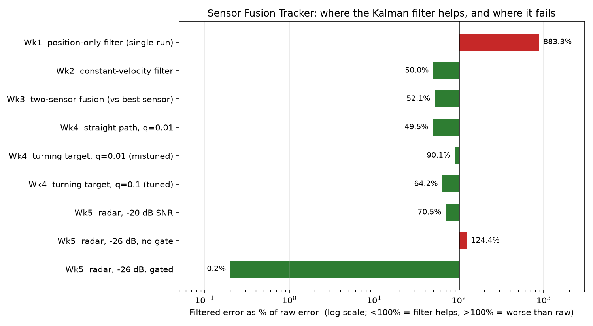
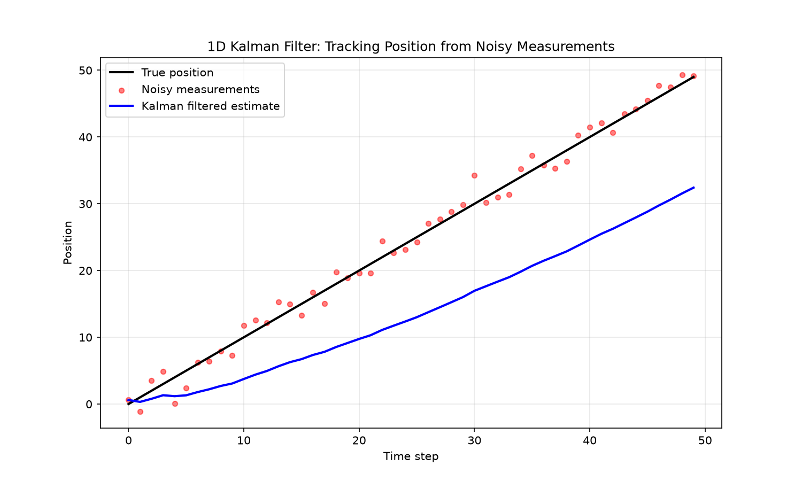
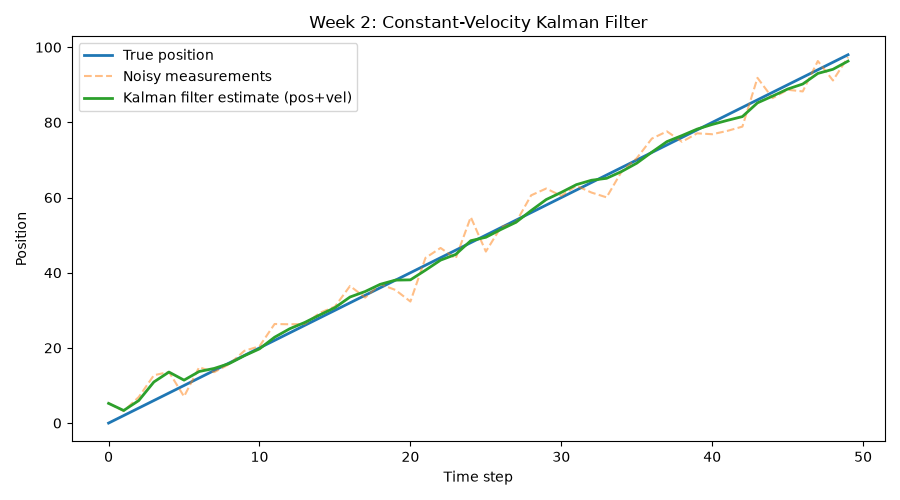
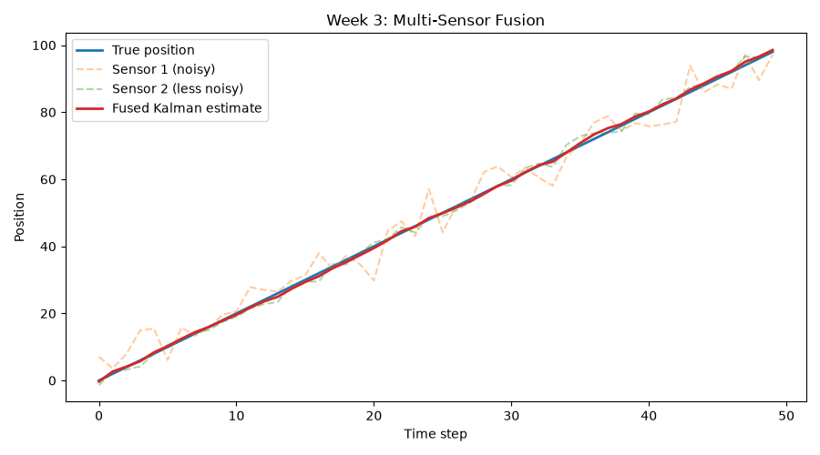
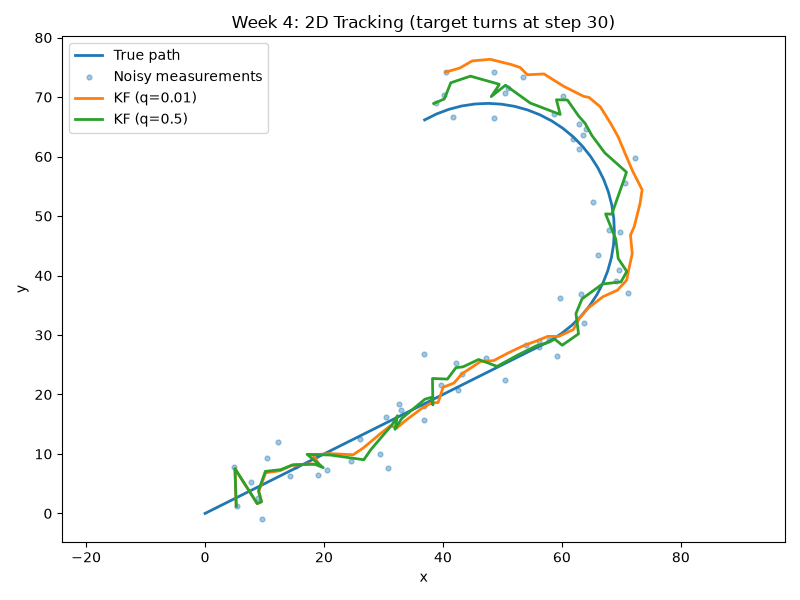
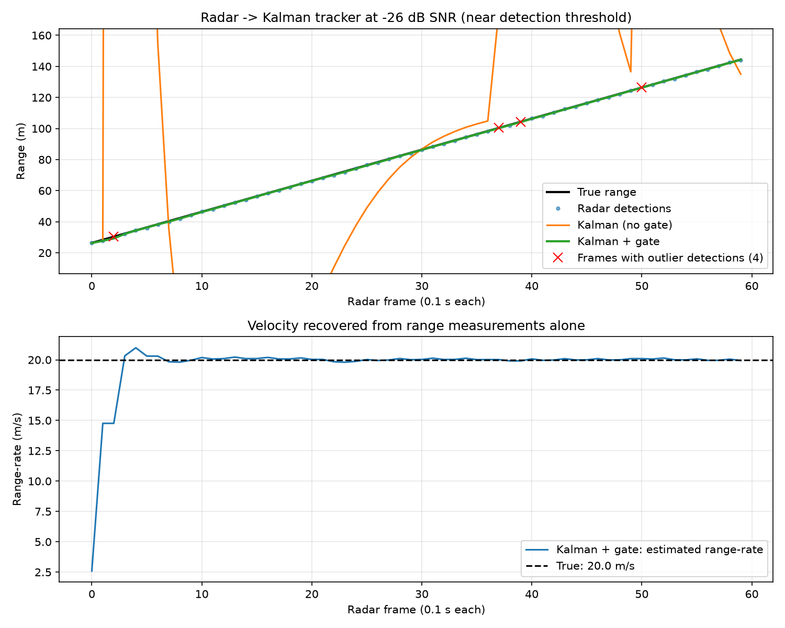

# Sensor Fusion Tracker

State estimation and sensor fusion in Python — Kalman filters built
from scratch, tracking noisy motion and fusing multiple sensors, with
a direct tie-in to real automotive/ADAS tracking pipelines.

## Results at a glance



Filtered error as a percentage of raw-measurement error (log scale).
Week 3 is measured against the best raw sensor, so it includes the gain
from filtering itself (fusion alone adds ~6%). The Week 5 raw baseline
at −26 dB is dominated by outlier detections.

| Week | What was built | Headline |
|---|---|---|
| 1 | Position-only Kalman filter | Worse than raw: the model assumes a stationary target |
| 2 | Constant-velocity model | 50% lower error |
| 3 | Two-sensor fusion | Lower error than either sensor; fusion alone adds ~6% (matches theory) |
| 4 | 2D tracking | 50% lower error on a straight path; a mistuned `q` nearly loses the gain on a turn |
| 5 | FMCW radar → tracker | Plain filter trusts outliers and is worse than raw; gating fixes it |

Three failure modes show up repeatedly: a **wrong motion model** (Weeks 1, 4),
**mis-tuned process noise** (Week 4), and **non-Gaussian outliers** (Week 5).

## Motivation

Real-world sensors are noisy. A single GPS reading, radar detection,
or accelerometer sample can't be fully trusted on its own — but by
modeling how a system *should* move (physics) and continuously
correcting that model with new noisy measurements, a Kalman filter
produces an estimate more accurate than any individual sensor alone.

This is the core algorithm behind ADAS (advanced driver assistance
systems), autonomous vehicle tracking, aircraft navigation, and radar
target tracking — built here from first principles rather than using
a library like `filterpy`, so every step is understood and verifiable.

This project connects directly to [sdr-simulator](https://github.com/Narenp-2003/sdr-simulator),
where Week 7 built an FMCW radar range estimator. Week 5 here feeds
that radar's noisy range measurements into a Kalman filter to
demonstrate a full detect-and-track pipeline.

## Project Structure

```
sensor-fusion-tracker/
├── src/
│   ├── kalman_1d.py       # Week 1 filter module
│   ├── week1_demo.py ... week5_demo.py
│   ├── radar_sim.py       # FMCW radar, from sdr-simulator
│   ├── monte_carlo.py     # 200-seed evaluation, Weeks 2-4
│   └── make_summary.py    # regenerates docs/summary.png
├── docs/                  # output plots
└── requirements.txt
```

## Setup

```
python -m venv sf-env
.\sf-env\Scripts\Activate.ps1
pip install -r requirements.txt
```

## Roadmap

- [x] **Week 1** — 1D Kalman filter (position-only state)
- [x] **Week 2** — 2D state vector (position + velocity), physics-based motion model
- [x] **Week 3** — Multi-sensor fusion (combining two noisy sensors)
- [x] **Week 4** — 2D plane tracking (x-y motion)
- [x] **Week 5** — Fusing radar data from `sdr-simulator` into the filter
- [x] **Week 6** — Visualization polish, final write-up

## Methodology

Each `weekN_demo.py` uses a fixed seed to draw its plot. The numbers in
the result tables for Weeks 2-4 come from `src/monte_carlo.py`, which
repeats every experiment over 200 random noise seeds and reports
mean ± std, so results don't depend on one lucky or unlucky noise draw.
Week 5 runs its own 200-seed evaluation inside `week5_demo.py`.

```
cd src
python monte_carlo.py
```

## Week 1: 1D Kalman Filter

Run:

```
cd src
python week1_demo.py
```

Implements the classic predict-correct Kalman filter loop, tracking a
1D position from noisy measurements, assuming a **position-only** state
(no explicit velocity model).

**Result — an important negative finding:** in the demo run, the
filtered estimate performed *worse* than the raw noisy measurements
(MAE 10.6 vs 1.2, a -750% "improvement"). This happens because the
filter's prediction step assumes the object stays still between
measurements, so it systematically lags behind a target moving at
constant velocity — smoothing confidently toward a wrong assumption
rather than just averaging out noise.

This motivates Week 2: adding velocity into the state vector so the
filter's predictions account for motion, not just measurement noise.



## Week 2: Constant-Velocity Kalman Filter

Run:

```
cd src
python week2_demo.py
```

Extends the state to `[position, velocity]` with a constant-velocity
motion model (`F = [[1, dt], [0, 1]]`, position-only measurement
`H = [1, 0]`), fixing the lag problem found in Week 1.

Setup: true velocity 2.0 units/step, measurement noise σ = 3.0,
50 steps.

**Result:** over 200 random seeds, MAE improved from 2.38 ± 0.26 (raw
measurements) to 1.19 ± 0.26 (filtered), a 50% improvement.

Note: Week 2 uses σ = 3.0 noise, different from Week 1, so MAE values
are not directly comparable across weeks.



## Week 3: Multi-Sensor Fusion

Run:

```
cd src
python week3_demo.py
```

Two independent sensors with different noise levels (σ = 4.0 and
σ = 1.5) measure the same position each step. Both measurements are
fused into a single state estimate via sequential Kalman updates
within each time step (predict once, then update with sensor 1, then
update again with sensor 2).

Mean over 200 seeds (± std):

| Estimator | MAE |
|---|---|
| Sensor 1 raw | 3.17 ± 0.35 |
| Sensor 2 raw | 1.19 ± 0.13 |
| Kalman, sensor 1 only | 1.53 ± 0.35 |
| Kalman, sensor 2 only | 0.66 ± 0.12 |
| **Kalman, fused** | **0.62 ± 0.11** |

**Result:** filtering gives most of the gain (sensor 2: 1.19 → 0.66).
Fusion adds a further ~6% (0.66 → 0.62), better in 143 of 200 seeds.
This matches theory: sensor 1 carries only ~14% as much information as
sensor 2 (1/σ²: 0.0625 vs 0.444), predicting a ~6.4% error reduction.

**Verification:** sequential updates match a single batch update with
stacked `H` and `R = diag(σ₁², σ₂²)` to within 1e-13, as expected for
independent sensor noise.



## Week 4: 2D Plane Tracking

Run:

```
cd src
python week4_demo.py
```

State is `[x, y, vx, vy]` with a constant-velocity model and noisy
(x, y) position measurements (σ = 3.0). Two scenarios: a straight-line
target, and a target that turns 6°/step from step 30. Each is run with
low (q = 0.01), medium (q = 0.1) and high (q = 0.5) process noise.
Metric: mean Euclidean position error, 60 steps.

Mean over 200 seeds (± std):

| Scenario | Raw | KF (q=0.01) | KF (q=0.1) | KF (q=0.5) |
|---|---|---|---|---|
| Straight line | 3.74 ± 0.28 | **1.85 ± 0.26** | 2.18 ± 0.25 | 2.48 ± 0.25 |
| Turning target | 3.74 ± 0.28 | 3.37 ± 0.34 | **2.40 ± 0.28** | 2.52 ± 0.26 |

**Result:** a low-noise filter halves the error on a straight path
but barely beats raw data on a turning target (3.37 vs 3.74), and is
worse than raw in 35 of 200 runs, because the constant-velocity model
is wrong — the same failure mode as Week 1.

**Choosing q:** process noise is the variance of the acceleration the
model doesn't capture. For this turn, a = vω ≈ 0.23 units/step², so
q ≈ a² ≈ 0.055. A sweep over q finds the best turning-target error
around q = 0.1-0.2, in the same range, while straight-line tracking
prefers a much smaller q. This is the core Kalman trade-off between
smoothing and responsiveness.



## Week 5: Radar-to-Tracker Pipeline

Run (needs `radar_sim.py`, copied from [sdr-simulator](https://github.com/Narenp-2003/sdr-simulator)):

```
cd src
python week5_demo.py
```

Full detect-and-track chain: an FMCW radar (500 MHz sample rate,
200 MHz bandwidth, 0.75 m range resolution) measures a target moving
away at 20 m/s, 10 frames/s. Each frame goes chirp → noisy echo →
beat-frequency FFT → range; those ranges feed a constant-velocity
Kalman filter with state `[range, range-rate]`. Measurement noise R is
calibrated from the radar itself (σ = 0.232 m, vs 0.217 m theory).

Mean over 200 seeds:

| SNR | Estimator | Range MAE (m) | Frames >5 m off | Velocity RMSE (m/s) |
|---|---|---|---|---|
| -20 dB | Raw radar | 0.224 | 0% | 3.539 |
| -20 dB | Kalman | **0.158** | 0% | **0.057** |
| -26 dB | Raw radar | 85.958 | 4.83% | 5304.768 |
| -26 dB | Kalman (no gate) | 106.917 | 51.34% | 223.142 |
| -26 dB | **Kalman + gate** | **0.174** | **0.05%** | **0.093** |

**Result:** at healthy SNR the filter cuts range error ~30% and
recovers closing speed ~60× more accurately than differencing raw
ranges. Near the radar's detection threshold (-26 dB), noise peaks
produce outlier detections; a plain Kalman filter trusts them and ends
up *worse than raw*, while innovation gating (reject if y²/S > 9)
restores sub-0.2 m tracking.

**Notes:** the radar has a −0.146 m range bias from truncating the echo
delay to whole samples (`int()`); a filter cannot remove a bias, and
switching to `round()` brings it to +0.003 m. Doppler is not modelled
(`f_start = 0`), so velocity comes from range history alone.



Full write-up: [docs/WRITEUP.md](docs/WRITEUP.md)

## License

MIT